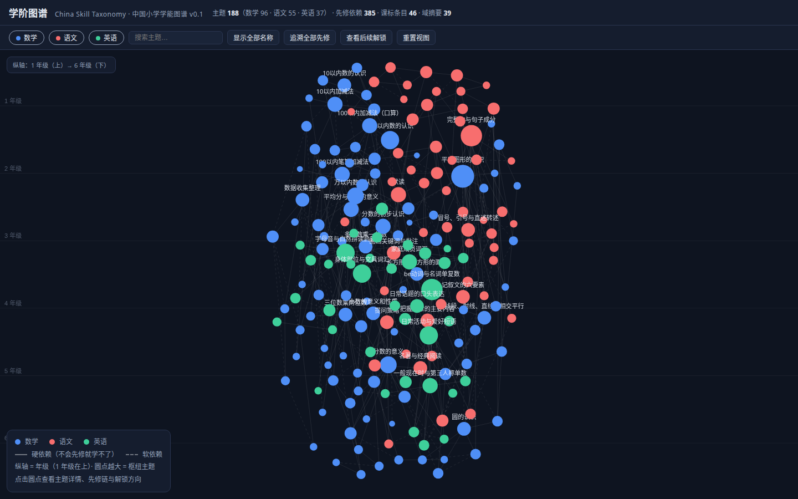
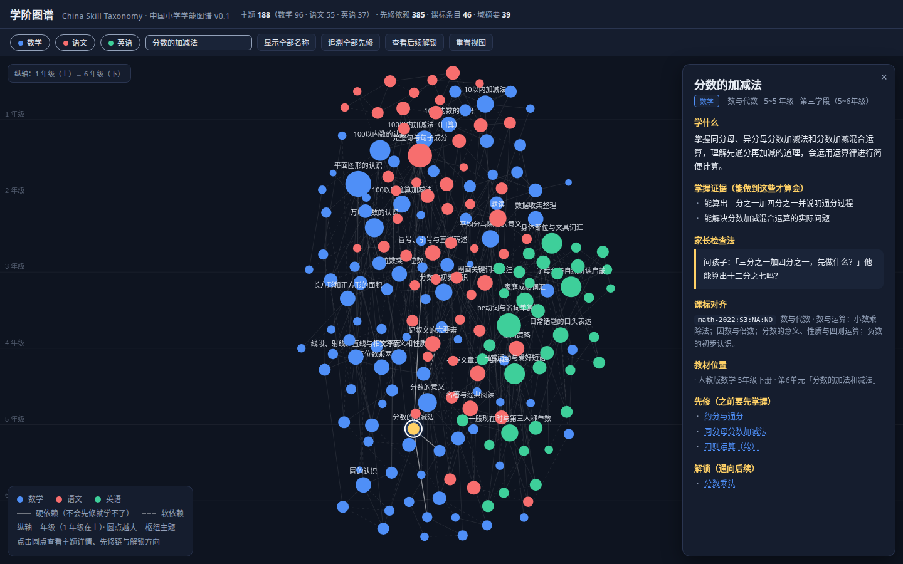
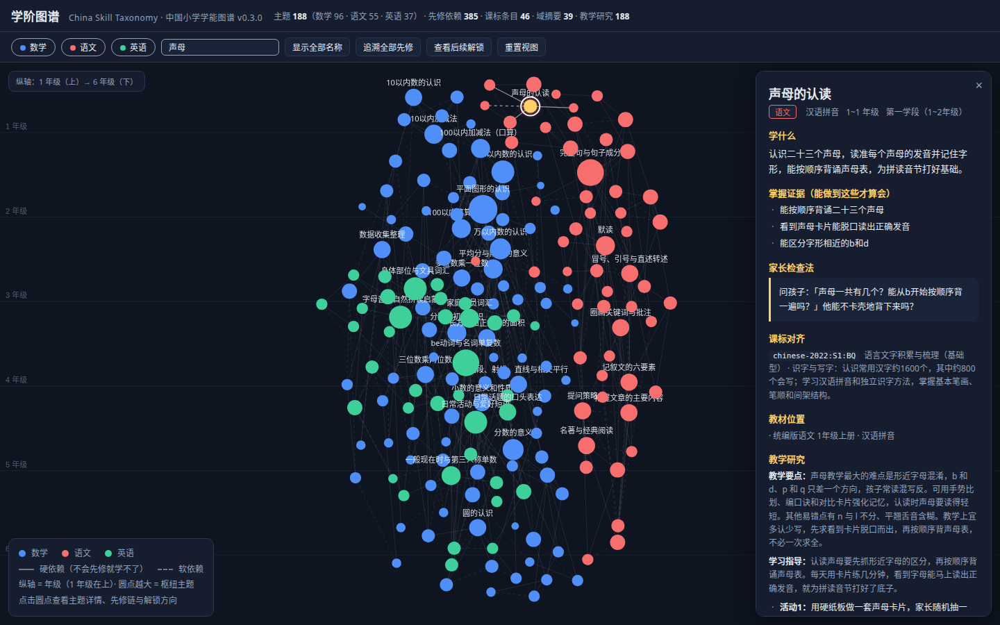
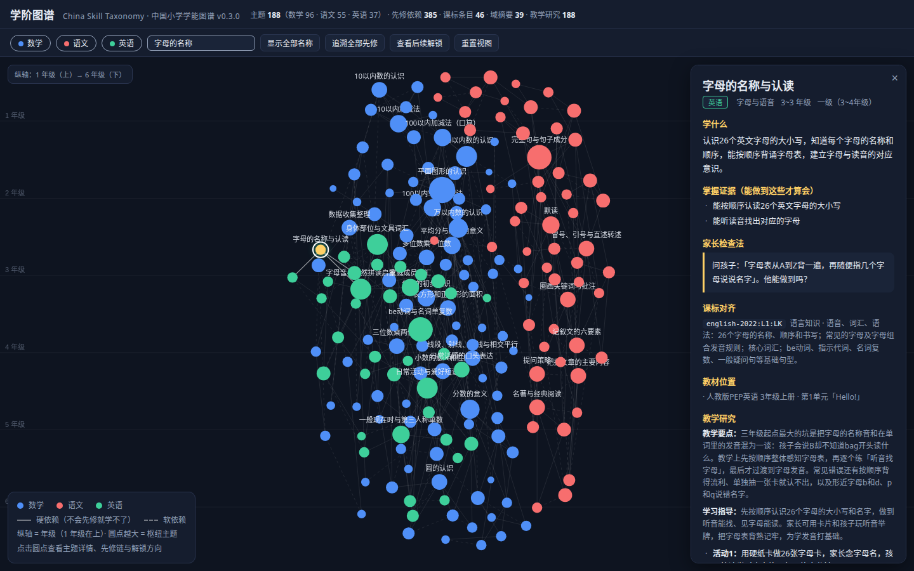

# 学阶图谱 · China Skill Taxonomy

**面向中国用户的 K12「学什么」开源知识图谱** —— 把从小学到高中的学习内容拆解为细粒度的「微主题」，连成先修依赖图，对齐《义务教育课程标准（2022年版）》/《普通高中课程标准（2017年版2020年修订）》与人教版/统编版教材，并为每个主题配上教学研究。当前覆盖 **10 个学科**（小学五科 + 初中八科 + 高中物理/化学/生物/历史/地理延伸），并已为高中**思想政治**、**技术**预注册学科管线（内容待后续版本填充）。**1009 个微主题全部配齐教学研究**（v0.20 起覆盖高中五科）。

> **版本：** `v0.20.0` · **主题：** 1009 · **先修依赖：** 1409 · **课标条目：** 157 · **域摘要：** 175 · **教学研究记录：** 1009（十学科覆盖，含高中物理/化学/生物/历史/地理）· **教材版本：** 21（含 2024 版 3）· **2024 版教材映射：** 137 条 · **其他版本映射：** 133 条

本项目对标 [Marble Skill Taxonomy](https://github.com/withmarbleapp/os-taxonomy)（面向英美课标的同类开放数据），是其**国产化版本**：数据、课标、教材全部换成中国体系，许可证与组织方式保持一致。

## 它是什么

大多数中文课程数据要么是一份平铺的课标目录，要么锁死在某个产品里。本项目提供的是一张**连通的学习图谱**：

- **1009 个微主题**（小学 265 + 初中 477 + 高中 267：数学 96+82、语文 55+67、英语 37+55、科学 39、道德与法治 38+23、物理 50+48、化学 42+54、历史 58+57、地理 49+50、生物 51+58）—— 每个主题是单一、可教、可检查的知识点或能力点（如「20以内进位加法」「比喻句与拟人句」「一般过去时」「一元二次方程」「议论文阅读」「定语从句」「植物的一生」「宪法是国家的根本法」「牛顿运动定律」「有机化合物」「减数分裂」「辛亥革命」「地球运动」），每个主题都带：
  - 一段家长能看懂的平实描述；
  - 2~3 条**可观察的掌握证据**（能做到什么才算会）；
  - 一条**家长检查法**（一个可以直接照着问的问题）；
  - 类型标注（概念性 / 程序性 / 表征性 / 语言性 / 元认知）、所属学科与领域、年级区间。
- **1409 条先修依赖** —— 有向无环图：「主题 A 依赖先修 B」，每条边标注 `hard`（不会先修就学不了）或 `soft`（有帮助但非必需），并附一句**知识上的原因**。把边反向即得「解锁」——学了这个之后能通向什么。小学与初中数学之间、各学科初中段内部也连了边（如「议论文阅读」依赖「现代文阅读方法」、「欧姆定律」依赖「电流与电路」）；**科学从一年级「观察方法」锚点到六年级「科学家这样做」连有跨年级方法链，初中道德与法治主题亦以小学段主题为先修**（如「理解法律对社会生活的作用」依赖「法律保护我们成长」）；高中物理/化学/生物/历史/地理在第五学段（10~12 年级）内部连边，并以初中对应学科主题为跨学段先修。
- **1009 条教学研究记录**（v0.2 数学 96 条，v0.3 补齐小学语文 55 条、小学英语 37 条；v0.9 新增初中数学 82 条；v0.11 补齐初中语文 122 条、初中英语 92 条；**v0.14 补齐初中物理 50 条、化学 42 条、历史 58 条、地理 49 条；v0.17 补齐小学科学 39 条、道德与法治 61 条；v0.18 补齐初中生物 51 条；v0.19 补齐高中物理 48 条、高中化学 54 条；v0.20 补齐高中生物 58 条、高中历史 57 条、高中地理 50 条**）—— 每个主题配一份「怎么教」：教学要点与常见错误、2~3 个家庭课堂可操作的学习活动（含期望体会、反馈建议、安排理由）、教学边界、一个可立刻照做的诊断任务（含表现水平、典型错误、下一步动作）与来源引用。**十学科 1009 个主题全量覆盖，`coverage.missingTopicIds` 已清空**。
- **157 条课标条目** —— 对齐《义务教育课程标准（2022年版）》与《普通高中课程标准（2017年版2020年修订）》条目：数学四领域 × 四学段、语文六个学习任务群（含第四学段）、英语三级（主题范畴与六要素）、**物理五主题（初中）+ 六主题（高中）、化学四主题（初中）+ 五主题（高中）、历史七主题（初中）+ 四模块（高中）、地理六主题（初中）+ 五模块（高中）、生物七主题（初中）+ 七模块（高中）**、**科学四领域 13 个学科核心概念 + 跨学科概念（第一至第三学段）、道德与法治六大学习主题 × 四学段**，每个微主题挂 1~3 条课标编号；高中物理、化学、生物、历史、地理的课标条目（第五学段）新接入。
- **教材对齐（21 个版本）** —— 人教版数学（小学 12 册 + 初中 7a~9b 6 册）、统编版语文（小学 12 册 + 初中 7a~9b 6 册）、人教版 PEP 英语（小学 3~6 年级 8 册 + 初中 7a~8b 五册及 9a 全一册）、**人教版物理（8a/8b/9a 全一册 + 高中 10a/10b/11a/11b/12a/12b 六册）、人教版化学（9a/9b + 高中 10a/10b/11a/11b/12a 五册）、统编版历史（7a~9b 六册 + 高中 10a/10b/11a/11b/12a 五册）、人教版地理（7a~8b 四册 + 高中 10a/10b/11a/11b/12a 五册）、人教版生物（7a/7b/8a/8b 四册 + 高中 10a/10b/11a/11b/12a 五册）、教科版科学（1~6 年级 12 册）、统编版道德与法治（小学 12 册 + 初中 7a~9b 六册）**的册次与单元目录，每个主题标注它通常出现的教材位置；**并已接入 2024 年版课标修订教材**（小学数学/语文一上至四上、英语三上至五上共 18 册 + 初中数学 7a~9a 共 5 册真实目录，137 条知识点 → 新版单元映射，含 101 条内容迁移说明），详情面板可一键并排对照新旧版单元树。初中数学九下（`9b`）与初中语文/英语暂用通行版目录，待修订版发布后替换。
- **科学/道法教材的版本现状（v0.16）** —— 教科版科学与统编版道德与法治同样处于 2022 年版课标修订教材的滚动启用期：新版按「一上 2024 秋 → 六上 2026 秋」逐年级推开，故**低年级册次（一上至三下）已为修订版目录，四上至六上按启用时间表标注、四下至六下暂沿用旧版目录**（小学道法一上 2024 秋起替换，4~6 下暂为旧版；初中道法七上 2024 秋、八上 2025 秋、九上 2026 秋已替换，九下暂为旧版）。新旧册次允许混合收录，各册次的版本状态在 `textbooks.json` 对应版本的 `note` 中如实说明，待修订版发布后逐册替换。
- **多版本教材对照（v0.15）** —— 除默认版本外，另收录 **北师大版数学（小学 12 册 / 130 单元）、苏教版数学（小学 12 册 / 119 单元）、外研社版英语（新标准·三年级起点，8 册 / 59 单元）**的真实目录，并为**小学数学 96 个、小学英语 37 个主题**建立「同一知识点在别版教材中的位置」映射（133 条，多数附版本编排差异说明）。主题的 `textbooks` 主引用仍为人教版/统编版，另以 `textbooksAlt` 与 `unitMapAlt` 承载替代版本，详情面板按版本分组展示。目录均抓取自电子课本网（dzkbw.com）真实册次；其中苏教版四下/五下/六下、外研社版五下/六下在源站仅有未标年份的旧版目录，已在版本说明中标注。
- **175 条域摘要** —— 按（学科 × 领域 × 学段）写给家长的通俗总结，回答「这个阶段这个领域到底在学什么」。

### 规模一览

| 学科 | 主题数 | 依赖边 | 课标条目 | 教学研究记录 |
|---|---:|---:|---:|---:|
| 数学 | 178（小学 96 + 初中 82） | 340 | 27（含第四学段 9 条） | 178（全覆盖） |
| 语文 | 122（小学 55 + 初中 67） | 178 | 24（小学 18 + 第四学段 S4 6） | 122（全覆盖） |
| 英语 | 92（小学 37 + 初中 55） | 141 | 15（小学 10 + 三级 L3 5） | 92（全覆盖） |
| 物理 | 98（初中 50 + 高中 48，8~12 年级） | 117 | 11（S4 五主题 + S5 六主题） | 98（全覆盖） |
| 化学 | 96（初中 42 + 高中 54，9~12 年级） | 122 | 9（S4 四主题 + S5 五主题） | 96（全覆盖） |
| 历史 | 115（初中 58 + 高中 57，7~12 年级） | 128 | 11（S4 七主题 + S5 四模块） | 115（全覆盖） |
| 地理 | 99（初中 49 + 高中 50，7~12 年级） | 140 | 11（S4 六主题 + S5 五模块） | 99（全覆盖） |
| 科学 | 39（小学 1~6 年级） | 52 | 14（四领域 13 概念 + 跨学科概念） | 39（全覆盖） |
| 道德与法治 | 61（小学 38 + 初中 23） | 84 | 21（六大主题 × 四学段） | 61（全覆盖） |
| 生物 | 109（初中 51 + 高中 58，7~12 年级） | 107 | 14（S4 七主题 + S5 七模块） | 109（全覆盖） |
| **合计** | **1009** | **1409**（hard 821 / soft 588） | **157** | **1009**（十学科全量覆盖，含高中物理/化学/生物/历史/地理） |

## 看看它

可视化页面在 `viz/index.html`，直接用浏览器打开即可（无需服务器、无外部依赖）：

- 每个圆点是一个微主题，**颜色区分 10 个学科**（数学蓝 / 语文红 / 英语绿 / 物理紫 / 化学橙 / 历史青 / 地理黄绿 / 科学粉 / 道法金 / 生物翠绿），**大小反映枢纽程度**（被多少主题依赖）；顶部彩色按钮可按学科开关；
- **三级层级**：学科（大圆环）→ 领域簇（中圆环，显示知识点数）→ 知识点（实心圆点），点击学科/领域簇可**折叠/展开**该分支，面板同步显示域摘要与下辖清单；
- **三种布局**随时切换（桌面端滚轮缩放 / 双击放大，移动端双指捏合 / 单指平移）：
  - **星图**——力导向 + 年级纵轴，按学科自然聚簇；
  - **长卷**——横轴为 18 个册次（1年级上 → 9年级下），纵轴为十条学科泳道，一眼看清知识沿年级的分布；
  - **热力**——学科 × 年级密度矩阵，颜色越深知识点越密集，点击格子直接跳回图谱并聚焦该学科；
- 实线是硬依赖、虚线是软依赖；
- 点击任意主题，右侧展开详情：学什么、掌握证据、家长检查法、课标对齐、教材位置、教学研究、先修链与解锁方向，详情里的先修/解锁条目可继续点击跳转；
- 「追溯全部先修」可一键算出并高亮**学会某个主题前需要掌握的全部先修闭包**（对标 Marble 官网的 concept tracing）；
- 支持按学科筛选、按名称搜索（**下拉结果列表**，可按名称或领域匹配，点击直达并聚焦）；
- **移动端适配**：触摸点击（按下—抬起判定，防误触）、**双指捏合缩放与单指平移（带惯性）**、详情面板底部抽屉、移动端默认折叠到「学科+领域簇」层（点簇下钻）、工具栏单行零横滚（低频操作收进「⋯」菜单）、图例可折叠、标签分层防碰撞、布局静止后自动停帧省电；手机（320~844px 宽）与桌面均可正常使用。
- **v0.4 交互层**——点击主题后可以真正「做事」：
  - **学习路径生成器**：一键算出「学会该主题之前要掌握的全部先修」，按依赖拓扑排序、按年级分阶段，支持「仅硬依赖（最短必需）/ 含软依赖」两种模式，可导出 Markdown 或直接打印；
  - **掌握标记 + 缺口诊断**：把孩子已会的主题标记为「已掌握」（浏览器本地保存），选中任意主题即显示进度条（已会/待补）与「下一步最该学」的边界集；图谱上已掌握主题带金色圆环，可一键隐藏专注待学；
  - **教材直达**：每条教材位置附「智慧教育平台」与「原书 PDF」（ChinaTextbook 仓库真实路径）直达链接；2024 版引用另附电子课本网「在线目录」。
  - **教材版本对照**（v0.7）：主题详情的教材位置区并列展示现役教材与 2024 年版课标修订教材的引用；点击「📖 教材版本对照」并排展示两版完整单元树，本知识点所在单元高亮并展开课节，迁移幅度大的主题附修订说明。
- **v0.12 交互增强**——找得到、看得清、传得开、跟得着：
  - **搜索下拉 + 年级/领域筛选**（找得到）：输入即列出匹配主题（带学科色点与年级区间），`↑↓` 选择、`Enter` 直达并聚焦；新增**年级区间**与**领域**两个下拉筛选（领域按学科分组，选中后自动开启对应学科），筛选时自动展开命中的领域簇；
  - **悬停高亮邻域 + 节点拖拽**（看得清）：鼠标悬停某主题即点亮它的先修/解锁邻居并加亮关联边、其余淡出（容器则点亮其下全部知识点）；拖动圆点可**固定位置**（白色虚线环标记），固定节点仍把其他节点推开，「重置视图」解除全部固定；
  - **网址深链分享**（传得开）：选中主题、学科/年级/领域筛选、布局都会写入网址 hash（如 `#t=mt_xxx&g=7&l=star`），刷新或转发链接可精确还原到该知识点视图；
  - **掌握进度 + 键盘导航**（跟得着）：顶部按学科与总体实时显示已掌握进度条与百分比（点击学科条可开关该学科）；`↑↓` 按年级顺序切换主题并自动居中，`/` 聚焦搜索、`m` 标记已掌握、`Esc` 关闭面板。









## 数据说明

所有数据在 [`data/`](data) 目录，UTF-8 JSON，无运行时依赖，加载即用。字段定义见 [`schema/`](schema) 的 JSON Schema，计数与 SHA-256 校验和见 [`data/manifest.json`](data/manifest.json)。

| 文件 | 内容 |
|---|---|
| `data/topics.json` | 微主题（图谱**节点**） |
| `data/dependencies.json` | 先修依赖（图谱**边**） |
| `data/curriculum-standards.json` | 课标条目（编号 + 概要 + 出处） |
| `data/textbooks.json` | 教材版本、册次与单元目录（含 ChinaTextbook 仓库 PDF 路径索引；2024 年版课标修订教材目录与 `unitMap2024` 知识点映射层；**v0.15 起另含北师大版/苏教版数学、外研社版英语三套替代版本目录与 `unitMapAlt` 映射层**；初中数学 7a~9b 六册、初中语文 7a~9b 六册、初中英语 7a~8b 五册及 9a 全一册，初中段暂为通行版） |
| `data/clusters.json` | 家长友好的域摘要（含层级 id 与 topicIds 归组，构成「学科 → 领域簇 → 知识点」三级结构） |
| `data/teaching-research.json` | 教学研究记录（1009 条，十学科全量覆盖，`coverage.missingTopicIds` 已清空） |
| `data/manifest.json` | 计数、分学科统计、逐文件校验和 |

### 一个主题

```json
{
  "id": "mt_num-10-recognition",
  "type": "CONCEPTUAL",
  "subject": "数学",
  "domain": "数与代数",
  "name": "10以内数的认识",
  "description": "认识0到10各数，会数数、读数、写数，理解「几个」和「第几个」的区别，知道0表示没有，初步建立数感。",
  "gradeRangeStart": 1,
  "gradeRangeEnd": 1,
  "stage": "第一学段（1~2年级）",
  "centrality": 0.0321,
  "evidence": ["能按顺序逐个点数物体并报出总数", "能分清「有几个」和「第几个」的不同问法", "会正确书写0到10各数"],
  "assessmentPrompt": "问{{name}}：「桌上有5块积木，第3块是什么颜色？一共有几块？」他能分别回答吗？",
  "standards": ["math-2022:S1:NA:NO"],
  "textbooks": ["pep-math:1a:u3"],
  "textbooks2024": ["pep-math-2024:1a:u1", "pep-math-2024:1a:u2"],
  "textbookNote2024": "10 以内数的认识拆分为「5以内」与「6～10」两个单元，连续编排。"
}
```

- `id` —— 稳定标识（`mt_` + 语义化短横线键），被依赖边和可视化引用。
- `type` —— `CONCEPTUAL` 概念性 / `PROCEDURAL` 程序性 / `REPRESENTATIONAL` 表征性 / `LANGUAGE` 语言性 / `META` 元认知。
- `stage` —— 学段（数学/语文/科学/道德与法治：第一~第四学段；英语：一级/二级/三级）。
- `assessmentPrompt` —— 家长可直接照着做的检查，含 `{{name}}` 占位符（孩子的名字），展示前替换或删除。
- `standards` —— 课标编号，键为 `<学科>-2022:<学段>:<领域/要素>`，在 `curriculum-standards.json` 中可查到对应概要。
- `textbooks` —— 现役教材位置，格式为 `<版本>:<册次>[:u<单元号>][#块标签]`，如 `pep-math:1a:u3`（人教版数学一上第3单元）、`tongbian-chinese:1a#汉语拼音`（统编语文一上·汉语拼音块）。
- `textbooks2024` —— 2024 年版课标修订教材的单元引用，格式 `<版本>-2024:<册次>[:u<单元号>][#活动名]`（如 `pep-math-2024:2b#时间在哪里`）；**空数组表示该主题所在册次尚未被新版替换**，仍沿用 `textbooks`。
- `textbookNote2024` —— 可选：新版教材的内容迁移/重组说明（如单元拆分、跨册移动、活动替代单设单元）。

### 一条依赖

```json
{
  "topicId": "mt_num-10-addsub",
  "prerequisiteId": "mt_num-10-recognition",
  "strength": "hard",
  "reason": "先会数数认数才能把一组物体分成两部分"
}
```

`topicId` **依赖** `prerequisiteId`。反向遍历即「解锁」。全图无环（`node scripts/validate.mjs` 会做拓扑校验）。

### 一条教学研究记录

```json
{
  "topicId": "mt_num-20-carry",
  "topicName": "20以内进位加法",
  "subject": "数学",
  "pedagogy": "凑十法是核心：看大数、拆小数、凑成十、再算十几。难点不在会不会算，而在懂不懂为什么拆……",
  "learn": {
    "summary": "学会凑十法：把小数拆出一部分与大数凑成10，再加剩下的。重点是说清为什么这样拆，速度可以慢慢练。",
    "activities": [
      {
        "action": "摆9根红小棒和6根黄小棒，让孩子把6拆出1根与9凑成10根，再算得数。",
        "insight": "把新问题变成10加几，就能用已有经验算。",
        "feedback": "做对了就让他换8加5自己拆；拆错了就问几和几能凑成10。",
        "rationale": "动手拆一次，比听十遍讲解更能体会凑十的道理。"
      }
    ],
    "constraints": ["凑十法之外不强行统一方法，逐一点数可作为过渡。"]
  },
  "assess": {
    "task": "出「9加5」，让孩子边摆小棒边讲怎么凑十、先算什么再算什么。",
    "levels": ["不会：只会逐一点数，说不出凑十思路。", "达标：主动把5拆成1和4，说清9和1凑十、再算10加4。"],
    "errors": ["把9拆开去凑6，增加无谓步骤。"],
    "nextMoves": ["先练熟9、8加几，再过渡到7加几，每类都说凑十过程。"]
  },
  "sources": [{ "claim": "对应课标第一学段「数与运算」中20以内进位加法的算理要求。",
                "source": "《义务教育数学课程标准（2022年版）》", "url": "https://basic.smartedu.cn/" }],
  "confidence": "medium",
  "verified": false
}
```

**关于教学研究层的诚实说明**（与 Marble 同款的披露标准）：

- 记录由 **AI 撰写**，经过结构化校验（字段完整性、长度、来源白名单、主题联结、覆盖清单），并经过事实层面的批评性检查；但它们是**研究启发的建议，不是经验证有效的干预方案**。
- 引用来源**未逐条重新联网复核**；`verified: false` 与 `confidence` 不是新的证据评级。
- 覆盖是**分阶段推进**的：v0.11 完成数学/语文/英语 392 个主题的教学研究；v0.13 新增初中物理/化学/历史/地理 199 个主题的数据层，v0.14 补齐其教学研究记录；v0.16 新增科学/道德与法治 100 个主题的数据层，v0.17 补齐其教学研究记录；v0.18 补齐初中生物 51 条；v0.19 补齐高中物理 48 条、高中化学 54 条；v0.20 补齐高中生物 58 条、高中历史 57 条、高中地理 50 条。`coverage.subjects` 逐科登记「已覆盖/总数」，当前 **1009 条记录覆盖十学科全部 1009 个主题**（数学 178/178、语文 122/122、英语 92/92、物理 98/98、化学 96/96、历史 115/115、地理 99/99、科学 39/39、道德与法治 61/61、生物 109/109），`coverage.missingTopicIds` 已清空。高中**思想政治**、**技术**学科管线已在 v0.19 预注册（学段区间 10~12 年级），内容待 v0.21 填充，故不计入当前覆盖。
- 学科按各自学段开设的年级建模，并非都覆盖 1~12：英语自 3 年级起、**科学仅小学 1~6 年级开设、道德与法治 1~9 年级全学段开设、物理 8~12 年级（初中 8~9 + 高中 10~12）、化学 9~12 年级（初中 9 + 高中 10~12）、历史 7~12 年级（初中 7~9 + 高中 10~12）、地理 7~12 年级（初中 7~8 + 高中 10~12）、生物 7~12 年级（初中 7~8 + 高中 10~12）**；高中思想政治、技术预注册于 10~12 年级，内容待后续版本；校验脚本按学科区间强制约束。
- 文件通过 `topicFileSha256` 绑定 `topics.json` 的字节；图谱变更后需重新构建（`python3 scripts/build.py`）。

## 快速开始

```bash
git clone <本仓库>
cd china-skill-taxonomy

# 数据校验（结构完整性、引用完整性、DAG 无环、SHA-256 校验和）
node scripts/validate.mjs

# 教学研究层专项测试（主题联结、覆盖清单、topicFileSha256 绑定）
node --test scripts/teaching-research.test.mjs

# 从 src/ 数据源重新生成 data/ 与 viz/data.js（一般不需要手动执行）
python3 scripts/build.py
```

### 在代码里使用

```js
import topics from './data/topics.json' with { type: 'json' };
import deps from './data/dependencies.json' with { type: 'json' };
import research from './data/teaching-research.json' with { type: 'json' };

const byId = new Map(topics.topics.map(t => [t.id, t]));
// 学会「异分母分数加减法」之前，需要先掌握什么
const prereqs = deps.dependencies
  .filter(d => d.topicId === 'mt_frac-addsub')
  .map(d => byId.get(d.prerequisiteId).name);

// 关联该主题的教学研究（十学科全覆盖）
const guidanceByTopic = new Map(research.records.map(r => [r.topicId, r]));
const guidance = guidanceByTopic.get('mt_num-20-carry');
console.log(guidance.pedagogy, guidance.learn.activities.length);
```

```python
import json

topics = json.load(open('data/topics.json'))['topics']
deps = json.load(open('data/dependencies.json'))['dependencies']

by_id = {t['id']: t for t in topics}
prereqs = [by_id[d['prerequisiteId']]['name']
           for d in deps if d['topicId'] == 'mt_num-20-carry']
print(prereqs)  # ['20以内数的认识与数位', '10以内数的分与合', '10以内加减法']
```

## 数据来源

| 层 | 来源 | 说明 |
|---|---|---|
| 课程标准 | 《义务教育课程方案和课程标准（2022年版）》（教育部），原文见[国家中小学智慧教育平台](https://basic.smartedu.cn/) | 本项目**只收录课标的结构化编号与一句话概要，不转载原文**；引用策略与权利边界见 [PROVENANCE.md](PROVENANCE.md) |
| 教材结构 | [国家中小学智慧教育平台「教材」栏目](https://basic.smartedu.cn/) + [TapXWorld/ChinaTextbook](https://github.com/TapXWorld/ChinaTextbook)（现役版册次与版本结构）+ [电子课本网](http://www.dzkbw.com/)（2024 年版课标修订教材目录，多源交叉核对） | 单元锚点采用通行版教材结构；新版教材目录与逐单元映射自 v0.7 起随数据发布 |
| 内容编写 | 本项目原创 | 主题描述、掌握证据、家长检查法、依赖关系均为原创撰写，未使用任何教材或课标原文 |

**关于新教材**：依据 2022 年版课标修订的义务教育教科书自 2024 年秋季起在起始年级启用，2026 年秋季完成全国小学、初中替换。本项目的主题内容与课标对齐不受教材版本更替影响；自 v0.7 起，`textbooks.json` 收录新版教材的真实目录，并通过 `unitMap2024` 与每个主题的 `textbooks2024` 字段提供逐单元映射（含内容迁移说明），可视化层可并排对照。新版启用时间表：一年级 2024 秋、二三年级 2025 秋、四五六年级 2026 秋全部替换；数学/语文三年级上册为 2025 秋启用；人教版 PEP 英语自三年级起每年替换一册；初中数学七年级 2024 秋（7a）/2025 春（7b）、八年级 2025 秋（8a）/2026 春（8b）、九年级上 2026 秋（9a）已接入，九下（9b）修订版尚未发布、暂录通行版目录。

**注意**：2022 年版数学课标已将「简易方程」调整至初中阶段，故本项目小学段不含该主题。

## 许可证（分层，使用前请读）

| 层 | 内容 | 许可证 |
|---|---|---|
| 数据库 | 数据集合、结构、ID、各类关系（`data/` 目录） | [ODbL 1.0](LICENSE) —— 可商用、需署名；衍生数据库须以相同许可保持开放 |
| 内容 | 本项目原创中文文本（描述、证据、检查法、依赖理由、域摘要等） | [CC BY-SA 4.0](LICENSE-CONTENT) —— 需署名，衍生内容相同方式共享 |
| 课标引用 | 课标编号与概要指向的原文 | **不属于本项目**，原文以国家中小学智慧教育平台公布为准，使用须遵守上游规定 |

ODbL 区分「衍生数据库」与「产出作品」：你可以把本数据用于产品、模型或应用而**不必开源你的产品**，只需把对图谱本身的改进以相同许可开放。署名时请注明：

> 学阶图谱 · China Skill Taxonomy (v0.10.0) · https://github.com/<your-org>/china-skill-taxonomy · licensed under ODbL 1.0 (database) and CC BY-SA 4.0 (content)

## 路线图

- [x] v0.2：教学研究层（怎么教：教学法、学习活动、反馈与评估指导）—— **数学 96 条已发布**
- [x] v0.3：语文、英语的教学研究层 —— **语文 55 条、英语 37 条已发布，三科 188 条全覆盖**
- [x] v0.4：交互层升级 —— **学习路径生成器、掌握标记与缺口诊断、教材直达链接**
- [x] v0.5：层级与多布局 —— **学科→领域簇→知识点三级结构（可折叠下钻）、长卷册次轴、热力矩阵**
- [x] v0.6：移动端整体重构 —— **三专家评审驱动的交互与布局改造（平移/缩放、标签分层、默认折叠、停帧省电）**
- [x] v0.7：2024 版课标修订教材的单元级映射 —— **18 册真实目录 + 137 条知识点映射 + 版本对照视图**
- [x] v0.8：初中段·数学 —— **初中数学 82 个微主题（7~9 年级）+ 151 条依赖边 + 第四学段课标 9 条 + 初中教材 6 册；年级/册次轴泛化到 K9**
- [x] v0.9：初中数学教学研究层 —— **为 82 个初中数学主题补齐教学研究记录，小学三科 + 初中数学教学研究全量覆盖（270 条）**
- [x] v0.10：初中语文、初中英语（数据层）—— **初中语文 67 + 初中英语 55 个微主题（7~9 年级）、第四学段 S4 六任务群 + 英语三级 L3 课标、统编版与人教版 Go for it! 教材接入；教学研究层留待 v0.11**
- [x] v0.11：初中语文、初中英语教学研究层 —— **为 122 个初中语文/英语主题补齐教学研究记录（初中语文 122 条、初中英语 92 条），`missingTopicIds` 清空，K9 三科 392 个主题教学研究全量覆盖**
- [x] v0.13：初中物理、化学、历史、地理（数据层）—— **199 个微主题（物理 50 / 化学 42 / 历史 58 / 地理 49）+ 302 条依赖边 + 四科课标 22 条 + 教材 4 版 15 册；可视化泛化到 7 学科（配色/筛选按钮/图例/布局横轴均改为数据驱动）；教学研究层留待 v0.14**
- [x] v0.14：初中物理/化学/历史/地理教学研究层 —— **为 199 个新主题补齐教学研究记录（物理 50、化学 42、历史 58、地理 49），`missingTopicIds` 清空，七科 591 个主题教学研究全量覆盖**
- [x] v0.15：扩展教材版本 —— **北师大版数学（小学 12 册/130 单元）、苏教版数学（小学 12 册/119 单元）、外研社版英语·新标准三起（8 册/59 单元）三套真实目录 + 133 条跨版本单元映射；可视化「其他教材版本」分组展示，教材引用正则改为数据驱动**
- [ ] 初中段教材版本扩展（北师大版/苏科版初中数学、外研社版初中英语）
- [ ] v0.21：高中思想政治 / 技术（数据层 + 教学研究层，启用 v0.19 预注册的学科管线）
- [ ] v0.22+：高中语文 / 数学 / 英语延伸（数据层 + 教学研究层，按学科建模 10~12 年级内容）
- [x] v0.16：科学、道德与法治学科（数据层）—— **科学 39 + 道德与法治 61 个微主题、136 条依赖边（含跨学段先修）、35 条课标（13 学科核心概念 + 六大学习主题）、教科版科学 12 册 + 统编版道德与法治 18 册实抓目录，可视化泛化到 9 学科**
- [x] v0.17：科学、道德与法治教学研究层 —— **补齐 100 条记录（科学 39、道德与法治 61），九学科 691 个主题教学研究全量覆盖，`missingTopicIds` 清空**
- [x] v0.18：生物教学研究层与数据层 —— **补齐初中生物（7~8 年级）数据层与教学研究层 51 条，十学科 742 个主题教学研究全量覆盖，`missingTopicIds` 清空**
- [x] v0.19：高中起步（数据层 + 教学研究层）—— **打通 10~12 年级（第五学段/英语四级）学段管线，新增高中思想政治、技术学科注册（内容待 v0.21）；首批补齐高中物理 48 个 + 高中化学 54 个微主题及其教学研究记录（含高中课标与人教版高中教材六册/五册对齐），`missingTopicIds` 清空，844 个主题教学研究全量覆盖**
- [x] v0.20：高中生物 / 历史 / 地理（数据层 + 教学研究层）—— **补齐高中生物 58 + 高中历史 57 + 高中地理 50 个微主题及其教学研究记录（含高中课标 16 条与人教版高中教材各 5 册对齐），`missingTopicIds` 清空，1009 个主题教学研究全量覆盖，高中五科齐备**
- [x] v0.12：交互式图谱 —— **搜索下拉结果列表 + 年级/领域筛选、悬停高亮邻域 + 节点拖拽固定、网址深链分享与还原、掌握进度条 + 键盘导航**（桌面与移动端均已实测）

## 贡献

欢迎补充主题、修正依赖、完善课标与教材映射。请阅读 [CONTRIBUTING.md](CONTRIBUTING.md)，并确保 `node scripts/validate.mjs` 全部通过。

## 致谢

- 方法学对标 [Marble Skill Taxonomy](https://github.com/withmarbleapp/os-taxonomy)（© Generative Spark, Inc.）
- 课标原文与电子教材：[国家中小学智慧教育平台](https://basic.smartedu.cn/)
- 教材册次结构参考：[TapXWorld/ChinaTextbook](https://github.com/TapXWorld/ChinaTextbook)
- 2024 年版课标修订教材目录：[电子课本网](http://www.dzkbw.com/)（启用时间表经安徽省教育厅、淮北市人民政府、硚口教育云等多方公开信息交叉核对）
