<div align="center">

<h1>学阶图谱 · China Skill Taxonomy</h1>

<p><strong>1268 个微主题，按先修关系连成一张图。</strong><br>
每个主题写清楚三件事：学什么，会到什么程度算会，卡住了该往回补哪一步。</p>

<p>对齐义务教育（2022 年版）与普通高中（2017 年版 2020 年修订）课程标准<br>
覆盖 12 个学科、1~12 年级，每个主题配一份教学研究</p>

<p>


</p>

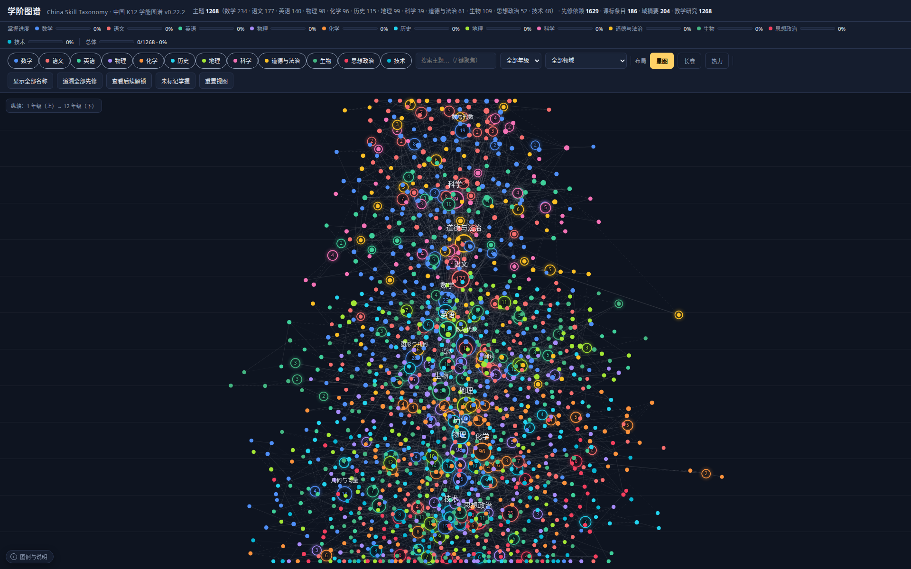

</div>

在线预览：<https://acd118508358062b1.app.workbuddy.host/?sharecode=DHL4TJAQCG>

> v0.42.0 · 主题 1273 · 先修依赖 1647（hard 952 / soft 695）· 课标条目 186 · 域摘要 204 · 教学研究 1268 · 教材版本 26 · 学科 12 · 课件 53

## 目录

- [这是什么](#这是什么)
- [项目特点](#项目特点)
- [课件层（试点）](#课件层试点)
- [已知的不足](#已知的不足)
- [覆盖范围](#覆盖范围)
- [快速开始](#快速开始)
- [数据说明](#数据说明)
- [数据来源与参考项目](#数据来源与参考项目)
- [许可证](#许可证)
- [路线图](#路线图)
- [贡献](#贡献)

## 这是什么

课标给范围和顺序，教材给章节和例题。家长拿着这两样东西，通常还是会卡在三个问题上：这个知识点要先会什么；学到什么程度算会；孩子说不会，该往回补哪一步。

这个项目把这三个问题做成数据。每个知识点是一个节点，先修关系是有向边，节点上挂着掌握证据、一句可以照着问的检查问题，以及一份「怎么教」的说明。全部以 JSON 发布，可以直接读，也可以接进自己的程序。

跟一份课标目录放在一起看，差别主要在这几处：

| | 课标目录 | 这里 |
|---|---|---|
| 一条记录是什么 | 一个领域或一章 | 一个知识点 |
| 记录之间 | 并列，没有先后 | 有先修边，标注硬依赖 / 软依赖和理由 |
| 学完的判据 | 范围要求 | 可观察的掌握证据 + 一句检查问题 |
| 给机器用 | PDF 或网页 | JSON + JSON Schema + 逐文件校验和 |

用的人大致分两类。一类是家长和老师，查某个年级该会什么，看孩子卡在哪一环，或者对照课标和教材定位一个知识点。另一类是开发者，把图谱接进自适应练习、课程规划、教材比对这类东西里。

## 项目特点

### 切到一节课讲得完的粒度

1268 个主题，大多数是一节课的量级，比如「20 以内进位加法」「定语从句」「动量守恒定律」。

切细的理由很实际。孩子说「函数没学好」，你没法直接补「函数」这一章。顺着依赖图往下走，可能断在「定义域」，也可能断在「单调性」的判断。定位到具体那一格，补起来才有数。

### 依赖写成图，不写成目录

1635 条边，每条标了 hard（不会先修就学不了）或 soft（有帮助但非必需），并附一句知识层面的理由，比如「动量守恒由动量定理在系统上推广」。

边反过来读就是「学会这个能解锁什么」。初中到高中的跨学段连接也在里面，所以补前置能一直往回追到小学。

### 每个主题配一份教学研究

1268 条记录，和主题一一对应。一条记录里有：教学要点与常见错误、两三个可以真做的活动（每个活动写了希望孩子体会到什么、做错了怎么反馈、为什么这么安排）、教学边界，以及一个诊断任务，分「不会 / 发展中 / 达标」三档，附典型错误和下一步。

这些文字是 AI 写的，经过结构校验，但没有经过实证验证。用法和边界见[下面的说明](#一条教学研究节选)。

### 课标和教材都落到具体编号

186 条课标条目，来自义务教育 2022 年版和普通高中 2017 年版 2020 年修订。每个主题挂 1~3 条编号，点开能看到该编号对应哪个领域、哪条要求。

教材做到单元级：26 套版本、册次和单元目录。其中包含 2024 年版修订教材的逐单元映射（137 条，多数附迁移说明），以及北师大版、苏教版数学和外研社版英语三套替代版本的对照。

### 可视化只有一个 HTML 文件

`viz/index.html` 加一个 `data.js`，没有构建步骤，没有外部依赖，也不用起服务器。三种布局（星图、长卷、热力），能搜索、按年级和领域筛选、追先修闭包、生成学习路径、标记已掌握。视图状态写进网址，复制链接就能定位到某个知识点。手机上单指平移、双指缩放。

### 数据可以自己重建

`data/` 里的 JSON 由 `src/` 的 Python 模块生成。`validate.mjs` 检查结构、引用完整性、DAG 有没有环、年级规则，以及每个文件的 SHA-256 是否对得上。改完数据跑三条命令，就知道有没有改坏。

<div align="center">
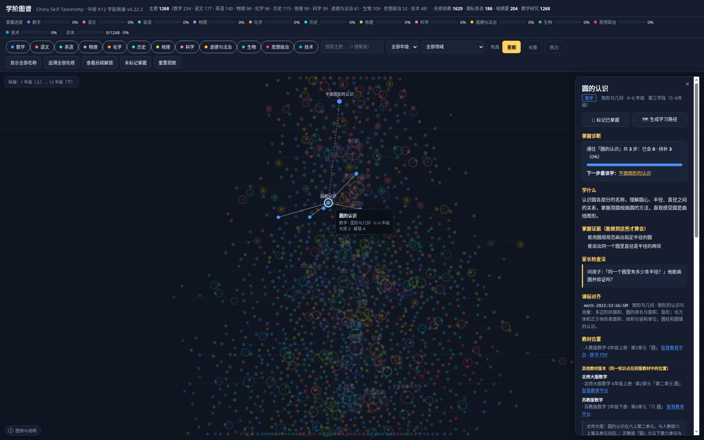
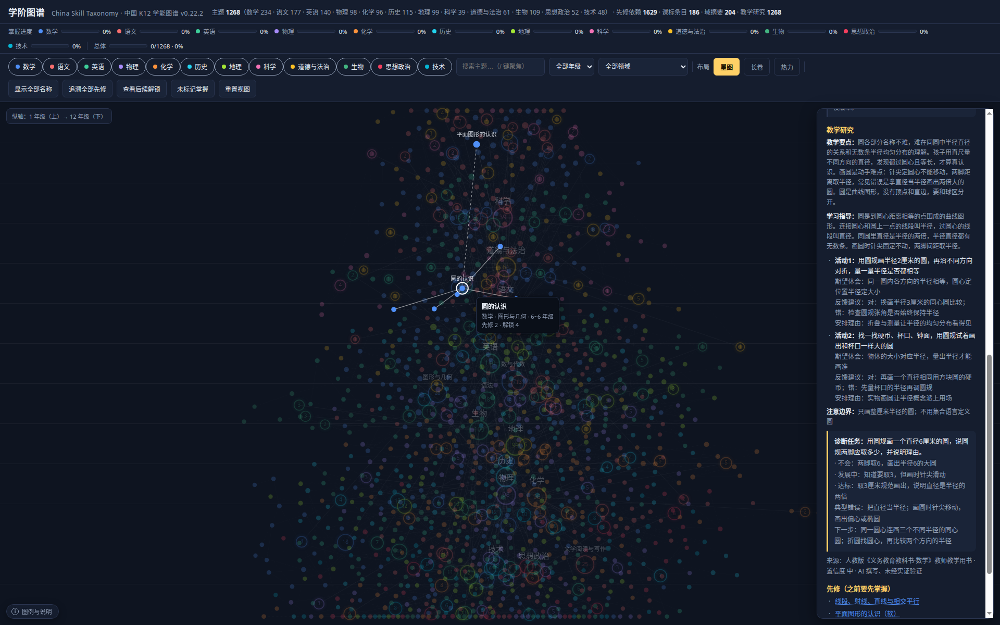
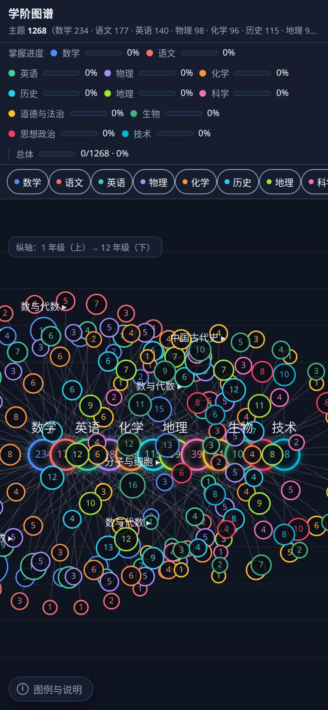
</div>

## 课件层

教学研究是写给大人的，课件是给孩子自己走的。

每个课件绑定一个 `topicId`，从图谱详情面板直达。走完会把完成状态写到本地，图谱上对应节点右上角出现一个绿点——和手动标记的「金色环」分开，因为「走完课件」不等于「真的掌握」。

现有 46 个：**三年级、四年级数学核心知识点全部配齐**，五年级已开十四块（小数乘除法、约分与通分、分数的意义与加减法、多边形面积、因数倍数、体积、位置、植树问题、可能性、统计等），另有四年级轴对称，以及九年级化学和高中线面角各一节：

| 课件 | 呈现方式 | 交互 | 时长 |
|---|---|---|---|
| 时、分、秒 | 钟面 | 拖动分针、两段动画、3 道判分题 | 16 分钟 |
| 万以内的加减法 | **竖式** | 6 道竖式题，进位与借位可单独标出 | 10 分钟 |
| 吨的认识 | **数轴** | 0~2000 千克数轴、1 吨标记、3 道换算题 | 12 分钟 |
| 倍的认识 | 方格图 | 2 行 × 3 个的摆法、求几倍与反求 | 12 分钟 |
| 多位数乘一位数 | **竖式** | 208×4 的进位标记、末尾有 0、估算 | 12 分钟 |
| 长方形和正方形的周长 | **描边图** | 四条边逐条高亮、靠墙围篱笆 | 13 分钟 |
| 分数的初步认识 | **分份图** | 4 等分取 1 份 / 3 份、分子分母辨析 | 13 分钟 |
| 同分母分数加减法 | 分份图 | 2/8+3/8 的涂色叠加、分母不变的道理 | 12 分钟 |
| 长方形和正方形的面积 | 方格图 | 一格一格铺满、换尺寸验证、100 格推导进率 | 14 分钟 |
| 高中物理 · 动量守恒 | 参数模拟 | 四个滑杆、碰撞动画、摩擦反例 | 16 分钟 |
| 长方体和正方体 | **3D 立体图** | 拖着转、按组高亮面/棱/顶点、摊平成展开图 | 12 分钟 |
| 除数是一位数的除法 | **除法竖式** | 试商、乘、减、落逐步展开；余数是否合理的判断 | 12 分钟 |
| 质量守恒定律 | 分子动画 | 断键、原子搬家、成键，底部原子清点始终不变 | 12 分钟 |
| 空间角（高中） | **棱锥 3D** | 线面角作射影 54.7°，二面角作垂线 63.4°，可拖着转 | 15 分钟 |
| 年、月、日 | **年历** | 12 个月按天数上色，二月可在平年/闰年之间切换 | 12 分钟 |
| 小数的初步认识 | **小数条** | 十格条涂格，0.1 一份一份数出来 | 10 分钟 |
| 一位小数加减法 | 小数条 | 加是合起来数，减是去掉几格 | 11 分钟 |
| 面积与面积单位 | 方格铺满 | 一格一格铺；边长用厘米，面积用平方厘米 | 11 分钟 |
| 复式统计表 | 复式表 | 男女两行对着比，合计自动求和 | 11 分钟 |
| 位置与方向 | **罗盘地图** | 八方向罗盘 + 社区地图走路线 | 10 分钟 |
| 加法运算律 | **运算律·交换/结合** | 28+17 与 17+28 对照；(28+17)+23 凑成整百 | 11 分钟 |
| 乘法运算律 | **运算律·交换/结合/分配** | 25×44 用面积模型拆成 25×40+25×4 = 1100 | 13 分钟 |
| 三角形的分类 | **三角形·分类** | 六个三角形逐个认；等腰直角三角形有两个名字 | 12 分钟 |
| 三角形的内角和 | **三角形·内角和** | 撕下三个角拼成一条直线，平角就是 180° | 12 分钟 |
| 三角形的三边关系 | **三角形·三边关系** | 3、5、7 围得成；反例 2+3<6 围不成 | 10 分钟 |
| 大数的认识 | **数位顺序表** | 满十进一从千位一路跳到亿位，亿级/万级/个级分级读数 | 11 分钟 |
| 角的度量与分类 | **量角器** | 中心对顶点、零线对一边；另一条边可以直接拖着量 | 11 分钟 |
| 平行四边形和梯形 | **四边形** | 成对箭头数平行组数：平行四边形两组，梯形只有一组 | 11 分钟 |
| 小数的意义和性质 | **百格图** | 1 格 0.01、一列 0.1；0.3 与 0.30 涂格一样多 | 12 分钟 |
| 三位数乘两位数 | **乘法竖式·两段部分积** | 145×12 两个部分积逐步揭示，十位一行向左错一位 | 12 分钟 |
| 除数是两位数的除法 | **除法竖式** | 把 18 看成 20 试商，试商→乘→减→落全程演示 | 12 分钟 |
| 条形统计图 | **统计图·条形** | 先看「一格表示几」，条形从基线逐条长出来 | 11 分钟 |
| 折线统计图 | **统计图·折线** | 先描点再连线，线段越陡变化越快 | 11 分钟 |
| 平均数 | **移多补少** | 红色移走、绿色补上，条形拉平到平均线 | 11 分钟 |
| 多边形的面积 | **割补拼摆** | 沿高剪开平移；两个三角形/梯形旋转 180° 拼合 | 13 分钟 |
| 因数与倍数 | **摆方格** | 12 个方格摆出 1×12、2×6、3×4，因数成对出现 | 11 分钟 |
| 分数的意义 | **可拖分份图** | 平均分对比、滑块改份数拖动涂色、一盒苹果看 3/4、3÷4=3/4 | 12 分钟 |
| 分数的加减法 | **分数条·通分** | 异分母先「重分」成 8 份，通分看得见 | 12 分钟 |
| 体积与容积单位 | **等距堆方块** | 小正方体一层层铺满长方体，每层个数×层数 | 12 分钟 |
| 位置（数对） | **数对网格** | 先列后行，点任意格子直接报数对 | 10 分钟 |
| 植树问题 | **可调间隔** | 拖间隔数、切三种栽法，棵数只差 ±1 | 11 分钟 |
| 轴对称 | **对称补全** | 拖对称点看距离相等，逐点补全另一半 | 10 分钟 |
| 约分与通分 | **重分分数条** | 同除/同乘「重分」分数条，涂色部分始终一样大 | 11 分钟 |
| 小数乘法 | **小数点定位** | 先按整数算 12×8=96，再数位点小数点 → 0.96 | 11 分钟 |
| 小数除法 | **商不变转化** | 5.6÷0.8 → ×10 → 56÷8，箭头演示同步移位 | 11 分钟 |
| 可能性 | **随机转盘** | 真随机转 12 次自动记账，频率靠近区域占比 | 11 分钟 |

<p align="center">
  
  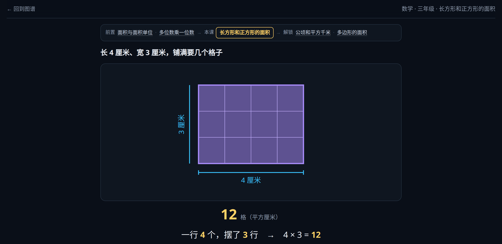
</p>

立体图形没有引 Three.js。手写一层投影——旋转矩阵、近大远小、按深度排序后再画——多出来的代码不到 300 行，却能拖着转、能一组一组高亮、能摊平成展开图，产物还是那个不联网的单文件。

<p align="center">
  
  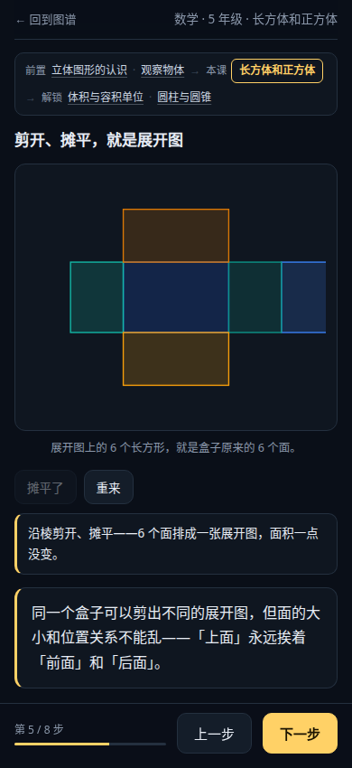
  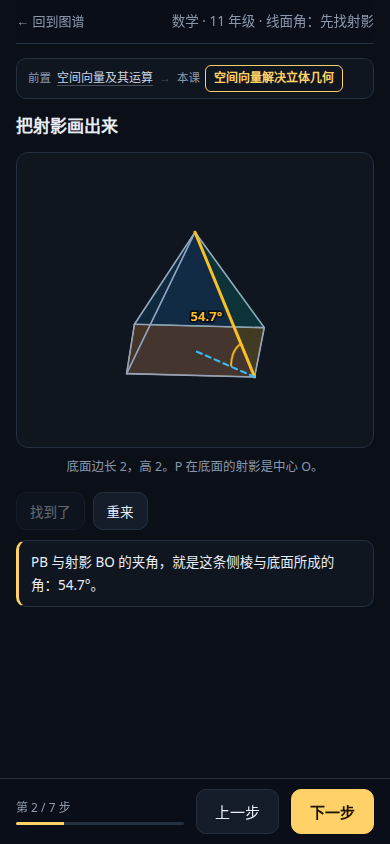
</p>

<p align="center">
  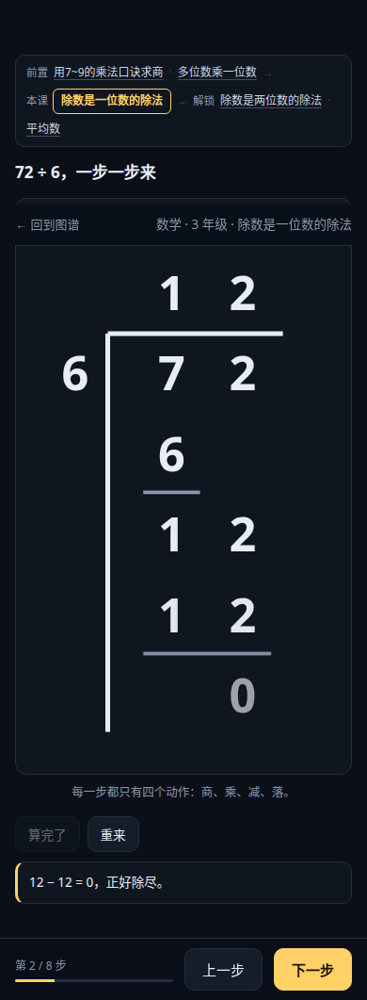
  
  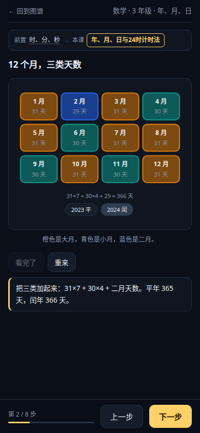
</p>

<p align="center">
  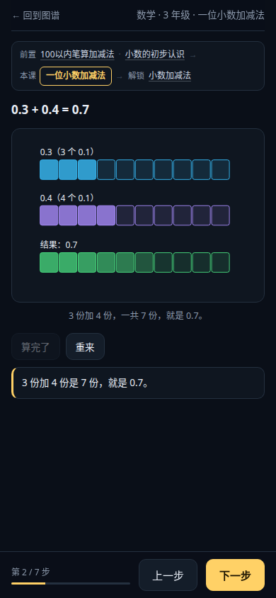
  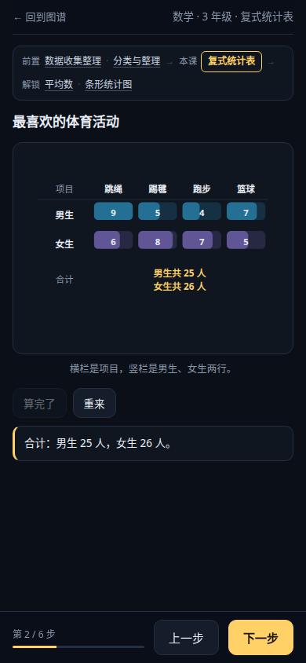
  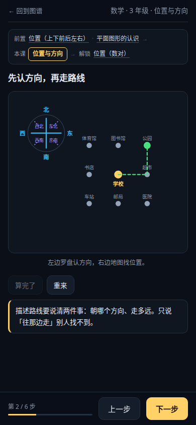
</p>

### 为什么分「教学结构」和「呈现方式」两层

只按教学结构分模板，所有课件都会长成「一段话 + 一个输入框」——竖式写成横式，几何只剩文字。而这恰好是学生最难靠文字理解的部分。

所以拆成两层，两件正交的事：

- **教学结构**（`explain` / `drill` / `explore` / `review`）决定顺序：先讲后练，还是先调参数再归纳。
- **呈现方式**（`vertical` / `geometry` / `clock` / `numberline` / `coords` …）决定画法：数位怎么对齐、方格怎么铺、指针怎么转。

组合起来才落得到具体主题：

| 主题类型 | 组合 | 效果 |
|---|---|---|
| 四则运算 | drill + `vertical` | 进位小 1 直接写在前一位上方，漏没漏一眼看得出 |
| 几何度量 | explain + `geometry` | 面积不是背公式，是一格一格数出来的 4×3=12 |
| 时间与单位 | explain + `clock` | 分针转一圈时针走一大格，动画走完才给结论 |
| 函数图像 | explore + `coords` | 参数改了曲线跟着动 |
| 物理规律 | explore + `sim` | 开个摩擦开关，守恒变不守恒 |

呈现器集中放在 `templates/renderers.js`，课件源文件用相对路径引用，构建时内联进单文件——同一套竖式代码只维护一份，不用在 1273 个主题里各抄一遍。

### 课件是数据，不是手写页面

导航、判分、结算、图谱延伸这些每课都一样的部分，收在 `templates/engine.js` 里；一份课件只剩 `content.json`：

```json
{ "topicId": "mt_mult-1digit",
  "steps": [
    { "type": "intro",    "title": "208 × 4，错的人大多错在这一位" },
    { "type": "vertical", "problem": { "a": 208, "b": 4, "op": "×" },
                          "note": "十位 0×4=0，加进位 3 得 3" },
    { "type": "quiz",     "question": "208 × 4 = ？", "answer": 832,
                          "why": "算出 802，是十位忘了加进位的 3" },
    { "type": "summary",  "points": ["一位一位乘", "满几十进几", "末尾的 0 补回来"] }
  ] }
```

`vertical` / `geometry` / `solid` / `numberline` / `clock` / `quiz` / `choice` 等 10 种步骤类型，覆盖概念、算理、练习三类场景。加一节课不用重写 HTML，只写这一份 JSON。

算理类的步骤会带一个「一步一步算」按钮，点一次推进一位：

| 呈现 | 一次点下去发生什么 |
|---|---|
| 竖式 | 高亮当位数位，点亮该位答案，冒出一个进位小 1，配一句「个位 8×4=32，写 2 进 3」 |
| 周长 | 描边一条边，图上累计「5 + 3 = 8 米」 |
| 分份 | 多涂一份，报「现在是 8 份里的 3 份」 |

不是播一段录好的动画，而是每次点击都对应一步真实计算——学生可以随时停下来，回头看上一步为什么这么写。

做一节课的顺序也写进了技能 [`skills/k12-courseware`](skills/k12-courseware/SKILL.md)：先从图谱取前置和课标，再判断这个点值不值得可视化，定一个认知动作，排 8 步，最后用脚本算答案、跑校验、打分。评分脚本会指出哪一项不合格——比如错项没写错因、前置指向了不存在的知识点。

### 课件与图谱是双向的

课件不是终点页，是图谱上的一个入口。

- **页首**一行位置条：`前置 A · B → 本课 C → 解锁 D · E`，每个名字都能点回图上对应节点。
- **页尾**三块延伸：回去补一补（先修 + 每条依赖边的理由）、接着学（解锁主题，优先有课件的）、这一课在图谱里是什么（领域、学段、课标编号、教材册次单元）。
- **图谱侧**：详情面板「打开课件（N 分钟）」，工具栏新增「▶ 有课件 N」开关，一键筛出所有能动手的主题。

这些数据不用手写。构建时按 `topicId` 从 `dependencies.json` 现算邻域，写成 `window.__GRAPH` 注入课件；主题的依赖改了，课件里的延伸跟着改。

| 文件 | 作用 |
|---|---|
| `courses/<topicId>/meta.json` | 元数据：教学结构、呈现方式、时长、课标、状态、版本 |
| `courses/<topicId>/index.html` | 课件（源文件引用共享模板，构建后内联为单文件） |
| `templates/base.css` · `renderers.js` | 共享样式与呈现器 |
| `data/courses.json` | 构建时生成的索引，随图谱一起加载 |

加一个新课件：

```bash
node scripts/new-course.mjs mt_rect-area --template=explain
node scripts/validate-courses.mjs
```

脚手架会自动带入主题描述、掌握证据、教学研究里的活动和常见错误，生成结构完整但需要改写的草稿。

完整方案——四层架构、教学结构与呈现方式的对应、质量门槛、生产流水线与路线图——见 [docs/COURSEWARE.md](docs/COURSEWARE.md)。

## 已知的不足

写在这里，省得用的人自己踩。

- 教学研究是 AI 撰写、经结构校验，但没有实证验证，来源也没有逐条联网复核。当参考，别当处方。
- 初中数学九下、初中语文和英语的部分册次仍用通行版目录，等修订版发布后替换。
- 1200 多个节点挤在一张星图里，1440 宽的屏幕上会偏密。星图适合看整体结构；找具体内容建议用搜索，或者先按学科筛一遍。
- 依赖图分成 67 个连通分量，最大的一块只占 7.6%。原因是跨模块、跨学科的边补得少，学习路径常常只能在本模块内走。补软依赖是下一步要做的，但每条都得能说清理由，不想为了连通而连通。
- 186 条课标里有 11 条还没有主题挂靠，集中在语文低年级的表达类要求、英语一级的两个要素；这部分主题偏少。
- 首屏要下载 4MB 的 `data.js`（gzip 后约 1MB），线上目前没有开压缩。数据分片是待办。
- 课件只有 53 个（1273 个主题的 4.2%），集中在数学一科，三、四、五年级核心知识点已配齐，六年级已开图形与几何的圆板块（圆的认识、圆的周长与面积、扇形、圆柱与圆锥）。呈现器落地了竖式、方格、描边、分份、钟面、数轴、坐标系、年历、小数条、复式表、罗盘地图、运算律、三角形、数位表、量角器、四边形、百格图、多位数乘法竖式、统计图、移多补少、割补拼摆、摆方格、分数意义图、分数加减条、等距堆方块、数对网格、植树间隔、对称补全、约分重分条、随机转盘、小数点定位、商不变转化、切饼分份、天平找次品、通话树、圆规画圆、滚圆测周长、扇形角控、圆柱展开四十种，sim / diagram / equation 还没做。构建改为按课程裁剪渲染器（扫描课件实际调用），单课体积从约 200KB 降到 40KB 上下。时分秒与动量守恒仍是各自内嵌的实现，没收敛到公共呈现器。
- 目前只有中文。术语和课标编号是中文体系的，翻成英文会失真，暂时没做。

## 覆盖范围

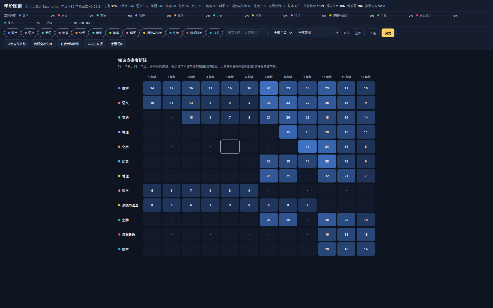

| 学科 | 主题数 | 依赖边 | 课标条目 | 教学研究 | 年级 |
|---|---:|---:|---:|---:|---|
| 数学 | 234（小学 96 + 初中 82 + 高中 56） | 390 | 32 | 234 | 1~12 |
| 语文 | 177（小学 55 + 初中 67 + 高中 55） | 222 | 30 | 177 | 1~12 |
| 英语 | 140（小学 37 + 初中 55 + 高中 48） | 184 | 20 | 140 | 3~12 |
| 物理 | 98（初中 50 + 高中 48） | 117 | 11 | 98 | 8~12 |
| 化学 | 96（初中 42 + 高中 54） | 122 | 9 | 96 | 9~12 |
| 历史 | 115（初中 58 + 高中 57） | 128 | 11 | 115 | 7~12 |
| 地理 | 99（初中 49 + 高中 50） | 140 | 11 | 99 | 7~12 |
| 生物 | 109（初中 51 + 高中 58） | 107 | 14 | 109 | 7~12 |
| 科学 | 39（小学 1~6） | 52 | 14 | 39 | 1~6 |
| 道德与法治 | 61（小学 38 + 初中 23） | 84 | 21 | 61 | 1~9 |
| 思想政治 | 52（高中） | 45 | 7 | 52 | 10~12 |
| 技术 | 48（高中，信息技术 + 通用技术） | 43 | 6 | 48 | 10~12 |
| **合计** | **1268** | **1635** | **186** | **1268** | 1~12 |

小学 265、初中 477、高中 526。学科按各自开设的年级建模：科学只在小学，思想政治和技术只在高中，物理从八年级开始。校验脚本按学科区间卡，越界会报错。

## 快速开始

### 先看图谱

不想装任何东西，clone 下来用浏览器打开就行：

```bash
git clone https://github.com/goralcao/china-skill-taxonomy.git
cd china-skill-taxonomy
open viz/index.html        # macOS；Windows 用 start，Linux 用 xdg-open
```

如果浏览器对本地文件有限制，起一个静态服务：

```bash
python3 -m http.server 8000 --directory viz
# 打开 http://localhost:8000
```

### 把数据读进自己的代码

三个文件就能用起来：主题、依赖、教学研究。

```js
import topics from './data/topics.json' with { type: 'json' };
import deps from './data/dependencies.json' with { type: 'json' };
import research from './data/teaching-research.json' with { type: 'json' };

const byId = new Map(topics.topics.map(t => [t.id, t]));

// 学会「动量守恒定律」之前要先会什么
const prereqs = deps.dependencies
  .filter(d => d.topicId === 'mt_phys-s-momentum-conservation')
  .map(d => ({ name: byId.get(d.prerequisiteId).name, strength: d.strength, reason: d.reason }));

// 这个主题怎么教
const guidance = research.records.find(r => r.topicId === 'mt_phys-s-momentum-conservation');
console.log(prereqs, guidance.learn.activities.length);
```

```python
import json

topics = json.load(open('data/topics.json'))['topics']
deps = json.load(open('data/dependencies.json'))['dependencies']
by_id = {t['id']: t for t in topics}

# 反过来查：学完这一个，后面能通向什么
unlocks = [by_id[d['topicId']]['name'] for d in deps
           if d['prerequisiteId'] == 'mt_phys-s-momentum-theorem']
print(unlocks)
```

### 改完数据跑三条命令

```bash
node scripts/validate.mjs                        # 结构、引用、DAG、年级规则、SHA-256
node --test scripts/teaching-research.test.mjs   # 教学研究层专项测试
python3 scripts/build.py                         # 从 src/ 重新生成 data/ 与 viz/data.js
```

三条都过再提交。数据不要手改，改 `src/` 里的源文件。

### 目录结构

```
china-skill-taxonomy/
├── data/          # 构建产物：topics / dependencies / clusters / standards / textbooks / teaching-research / manifest
├── schema/        # JSON Schema（主题、依赖、课标、教材、教学研究）
├── src/           # 数据源：按学科拆分的 Python 模块（主题、课标、教材目录、教学研究）
├── scripts/       # build.py（生成 + 校验和）、validate.mjs、validate-courses.mjs、new-course.mjs
├── viz/           # 单文件可视化（index.html + data.js）
├── courses/       # 课件源文件（每个主题一个目录：meta.json + index.html）
├── docs/          # README 截图
├── PROVENANCE.md  # 数据来源与权利边界
├── CITATION.cff   # 引用信息
├── LICENSE        # ODbL 1.0（数据库）
└── LICENSE-CONTENT # CC BY-SA 4.0（原创文本）
```

## 数据说明

数据都在 [`data/`](data)，UTF-8 JSON，没有运行时依赖。字段定义在 [`schema/`](schema)，计数和逐文件 SHA-256 在 [`data/manifest.json`](data/manifest.json)。

| 文件 | 内容 |
|---|---|
| `topics.json` | 微主题（节点）：描述、掌握证据、家长检查法、类型、学段、课标与教材引用 |
| `dependencies.json` | 先修依赖（边）：`topicId` 依赖 `prerequisiteId`，标 hard / soft 和理由 |
| `curriculum-standards.json` | 课标条目：编号、出处、领域、主题、一句话概要 |
| `textbooks.json` | 教材版本、册次、单元目录；2024 版映射 `unitMap2024`、替代版本映射 `unitMapAlt` |
| `clusters.json` | 学科 → 领域簇 → 知识点的层级归组，以及写给家长的域摘要 |
| `teaching-research.json` | 教学研究记录 1268 条，附 authorship 披露与 coverage 清单 |
| `courses.json` | 课件索引：topicId、模板、时长、课标、状态、路径 |
| `manifest.json` | 版本、计数、分学科统计、逐文件校验和 |

### 一个主题（节选）

```json
{
  "id": "mt_phys-s-momentum-conservation",
  "type": "CONCEPTUAL",
  "subject": "物理",
  "domain": "动量与守恒",
  "name": "动量守恒定律",
  "description": "系统不受外力或合外力为零时总动量不变；是自然界基本守恒律之一，适用于碰撞、爆炸等过程的分析。",
  "gradeRangeStart": 11,
  "gradeRangeEnd": 11,
  "stage": "第五学段（10~12年级）",
  "evidence": ["能说出动量守恒的条件", "能判断某过程动量是否守恒"],
  "assessmentPrompt": "让{{name}}分析冰面上两人互推后各自运动，总动量是否守恒并说明条件。",
  "standards": ["physics-2022:S5:CONS"],
  "textbooks": ["pep-physics-senior:11b:u1"],
  "clusterId": "cl-physics-d15-s5"
}
```

几个字段值得单独说：

- `id` 是稳定标识，依赖边和可视化都靠它引用。
- `type` 分五类：概念性、程序性、表征性、语言性、元认知。
- `assessmentPrompt` 是家长能直接照着问的一句话，`{{name}}` 是孩子的名字占位符。
- `standards` 格式为 `<学科>-2022:<学段>:<领域>`，可在课标文件里查到概要。
- `textbooks` 格式为 `<版本>:<册次>[:u<单元>][#块]`；`textbooks2024` 为空，表示这一册还没被新版替换。

### 一条依赖

```json
{
  "topicId": "mt_phys-s-momentum-conservation",
  "prerequisiteId": "mt_phys-s-momentum-theorem",
  "strength": "hard",
  "reason": "动量守恒由动量定理在系统上推广"
}
```

### 一条教学研究（节选）

```json
{
  "topicId": "mt_phys-s-momentum-conservation",
  "pedagogy": "动量守恒条件「系统合外力为零」常被记成「没有力」。教法是强调看系统外部有没有净力……",
  "learn": {
    "summary": "系统不受外力或合外力为零时总动量不变……",
    "activities": [
      {
        "action": "分析冰面上两人互推后各自运动，总动量是否守恒。",
        "insight": "内力不改变总动量。",
        "feedback": "若说有外力就提示冰面近似无摩擦。",
        "rationale": "用近似无外力情境建立守恒感。"
      }
    ],
    "constraints": ["只做情境分析，不真正在冰面或做爆炸实验。"]
  },
  "assess": {
    "task": "分析冰面上两人互推后各自运动，总动量是否守恒并说明条件。",
    "levels": ["不会：把「有力」当「不守恒」。", "达标：正确判断并说明合外力为零条件。"],
    "errors": ["把内部作用力当破坏守恒。"],
    "nextMoves": ["多练有/无外力对比。"]
  },
  "sources": [{ "claim": "课标要求理解动量守恒定律，能判断守恒条件并应用。", "source": "《普通高中物理课程标准（2017年版2020年修订）》" }],
  "confidence": "high",
  "verified": false
}
```

这些记录是 AI 写的，经过字段完整性、长度、来源白名单、主题联结和覆盖清单的校验，构建时还会检查引用能否解析。但它们没有经过实证验证，不是经验证有效的教学方案；引用来源也没有逐条联网复核。`verified` 一律是 `false`，`confidence` 是撰写时的自评，不是证据等级。文本全部原创，不抄课标、教材或教参原文。

## 数据来源与参考项目

### 参考了什么

数据组织方式参考了 [Marble Skill Taxonomy](https://github.com/withmarbleapp/os-taxonomy)：微主题、先修 DAG、课标对齐、分层许可、校验和这一套。对方的许可是 ODbL 1.0（数据库）加 CC BY-SA 4.0（内容），版权归 Generative Spark, Inc.。

这里的数据和文本都是自己写的，没有使用对方的任何内容、标识或字段值。如果你要做英文体系或别的国家的版本，那个仓库是个不错的起点。

| 项目 | 用在哪里 | 许可 / 性质 |
|---|---|---|
| [Marble Skill Taxonomy](https://github.com/withmarbleapp/os-taxonomy) | 方法学参考：数据组织、许可分层、先修追溯的交互 | ODbL 1.0 + CC BY-SA 4.0，© Generative Spark, Inc. |
| [TapXWorld/ChinaTextbook](https://github.com/TapXWorld/ChinaTextbook) | 教材册次结构；主题详情里的「原书 PDF」链接指向它 | 第三方开源仓库，只做外链，不镜像 |
| [电子课本网](http://www.dzkbw.com/) | 2024 年版修订教材的单元目录 | 第三方网站，只记录册次和单元名 |
| [国家中小学智慧教育平台](https://basic.smartedu.cn/) | 课标原文和电子教材的官方入口 | 官方平台，原文权利归发布方 |

### 同类的技能项目

课件层开工前扫过一遍现成的教育类 agent 技能，结论是它们做「一道题」「一节课」「一个知识点」，缺的正好是中间那张关系网。四家的取舍记在 [`docs/EDU-SKILLS-SURVEY.md`](docs/EDU-SKILLS-SURVEY.md)，这里只留结论：**没有一个被安装成依赖，也没有一行代码进仓库**；借的是几条设计规则（分步揭示、概念反馈、干扰项写迷思概念、计算内核与模板分离）。

| 项目 | 做到哪一步 | 许可 | 这里用了什么 |
|---|---|---|---|
| [k12-teacher-skills](https://github.com/anthropics/k12-teacher-skills) | 一节课：教案、分层、形成性检测 | Apache-2.0 | 借 eval 评分表和「干扰项来自迷思概念」的做法 |
| [math-viz-kit](https://github.com/edu-ai-builders/math-viz-kit) | 一个知识点：123 个单文件可视化 | 未声明许可证 | 借 `教学法规则库` 的 V1–V8，代码不可复制 |
| [edulab](https://github.com/wy51ai/edulab) | 一道题：3D/2D 解题页与讲解视频 | Apache-2.0 | 借「计算内核 + 数据驱动模板」的架构 |
| [awesome-agent4edu](https://github.com/xdelin/awesome-agent4edu) | 索引 | — | 按图索骥找上面的项目 |

### 各层的数据从哪来

| 层 | 来源 | 怎么处理 |
|---|---|---|
| 义务教育课标 | 教育部《义务教育课程方案和课程标准（2022 年版）》 | 只收编号和一句话概要，不转载原文 |
| 普通高中课标 | 教育部《普通高中课程方案和课程标准（2017 年版 2020 年修订）》 | 同上 |
| 教材结构 | 智慧教育平台、电子课本网、ChinaTextbook | 只记录册次、单元名和目录结构，不收教材正文 |
| 主题与依赖 | 原创撰写 | 描述、掌握证据、检查法、依赖理由都是自己写的 |
| 教学研究 | 组织撰写（AI 辅助 + 结构校验） | 原创文本，来源按白名单引用 |

逐层的权利说明和合规边界在 [`PROVENANCE.md`](PROVENANCE.md)。

### 引用

仓库里有 [`CITATION.cff`](CITATION.cff)，GitHub 会显示「Cite this repository」。也可以直接用：

```bibtex
@misc{china_skill_taxonomy_2026,
  title        = {学阶图谱 · China Skill Taxonomy},
  author       = {{China Skill Taxonomy contributors}},
  year         = {2026},
  version      = {v0.41.0},
  url          = {https://github.com/goralcao/china-skill-taxonomy},
  note         = {Database licensed under ODbL 1.0; content under CC BY-SA 4.0}
}
```

## 许可证

| 层 | 内容 | 许可证 |
|---|---|---|
| 数据库 | `data/` 里的数据集、结构、ID 和关系 | [ODbL 1.0](LICENSE)：可商用，需署名；衍生数据库要用同样的许可开放 |
| 内容 | 原创中文文本（描述、证据、检查法、依赖理由、域摘要、教学研究） | [CC BY-SA 4.0](LICENSE-CONTENT)：需署名，衍生内容同样方式共享 |
| 课标引用 | 课标编号和概要指向的原文 | 不属于本项目，以官方发布为准 |

ODbL 把「衍生数据库」和「产出作品」分开。拿这份数据做产品、训练模型、放进应用，都不需要开源你的产品；只有当你发布基于它的数据库时才需要同样开放。署名可以照抄这行：

> 学阶图谱 · China Skill Taxonomy (v0.33.0) · https://github.com/goralcao/china-skill-taxonomy · ODbL 1.0 (database) + CC BY-SA 4.0 (content)

## 路线图

<details>
<summary>已完成的版本和后续计划</summary>

| 版本 | 做了什么 |
|---|---|
| v0.2 ~ v0.3 | 教学研究层起步：数学 96、小学语文 55、小学英语 37 |
| v0.4 ~ v0.7 | 交互层：学习路径、掌握标记、教材直达、三级层级、多布局、2024 版教材映射 |
| v0.8 ~ v0.11 | 初中数学、语文、英语，K9 三科全量覆盖 |
| v0.12 | 搜索下拉、年级与领域筛选、悬停高亮、节点拖拽、深链分享、键盘导航 |
| v0.13 ~ v0.15 | 初中物理、化学、历史、地理；多版本教材目录与跨版本映射 |
| v0.16 ~ v0.18 | 科学、道德与法治、生物，十学科 742 主题全量覆盖 |
| v0.19 ~ v0.22 | 高中九科补齐，1268 主题、十二学科全量覆盖 |
| v0.22.1 ~ v0.42.0 | 图例可收缩、触摸修复、课件演算、技能与评分、3D 立体图、除法竖式、分子动画、年历、小数条与罗盘地图 |

还没做的：

- [ ] 初中段教材版本扩展（北师大版 / 苏科版初中数学、外研社版初中英语）
- [ ] 教学研究补充证据链接，并标出人工复核过的条目
- [ ] 提供 npm / PyPI 数据包和增量更新脚本
- [ ] 英文文档与字段说明

逐版本明细在 [CHANGELOG.md](CHANGELOG.md)。

</details>

## 贡献

补主题、修依赖、改课标和教材映射、重写教学研究，都欢迎。动手前看一眼 [CONTRIBUTING.md](CONTRIBUTING.md)，那里写了字段要求和几条硬规则（依赖不能成环、文本必须原创）。

提 PR 前跑一遍：

```bash
python3 scripts/build.py && node scripts/validate.mjs && node --test scripts/teaching-research.test.mjs
```

## 致谢

- [Marble Skill Taxonomy](https://github.com/withmarbleapp/os-taxonomy)：方法学上的参照（© Generative Spark, Inc.）
- [国家中小学智慧教育平台](https://basic.smartedu.cn/)：课标原文与电子教材入口
- [TapXWorld/ChinaTextbook](https://github.com/TapXWorld/ChinaTextbook)：教材册次与 PDF 索引
- [电子课本网](http://www.dzkbw.com/)：2024 年版教材目录
- [math-viz-kit](https://github.com/edu-ai-builders/math-viz-kit)：课件分步揭示与概念反馈的设计参照
- [k12-teacher-skills](https://github.com/anthropics/k12-teacher-skills)：形成性检测与迷思概念干扰项的做法参照
